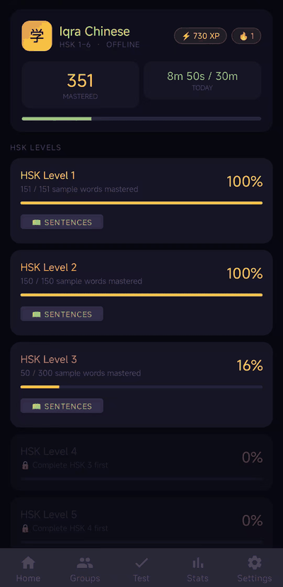
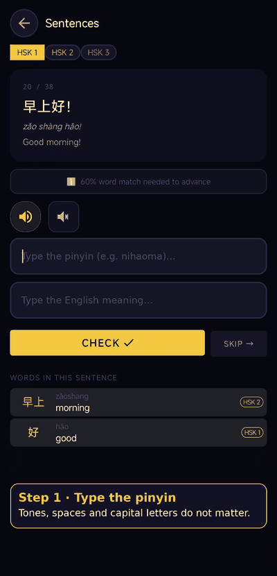
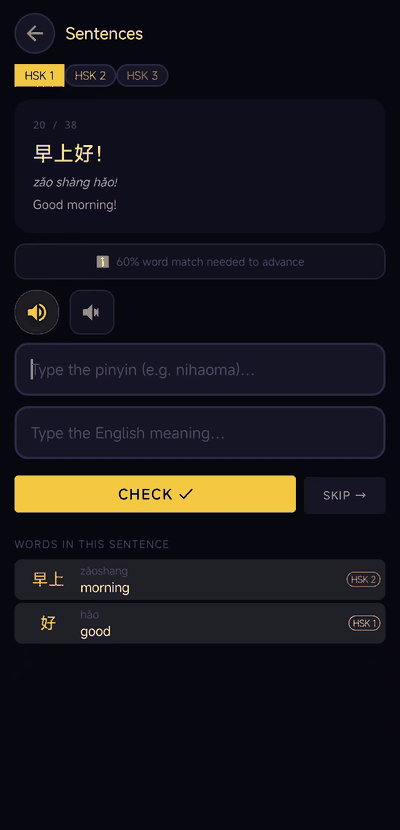
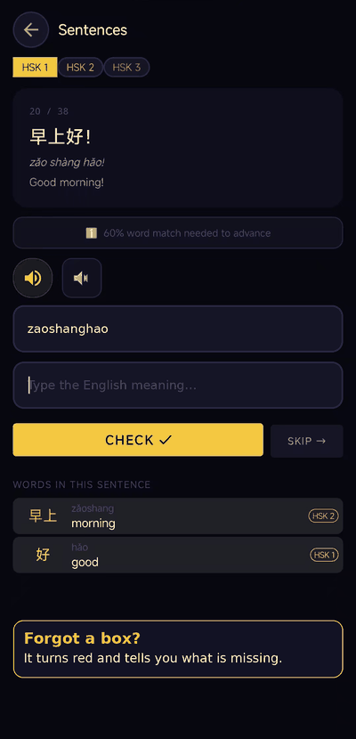
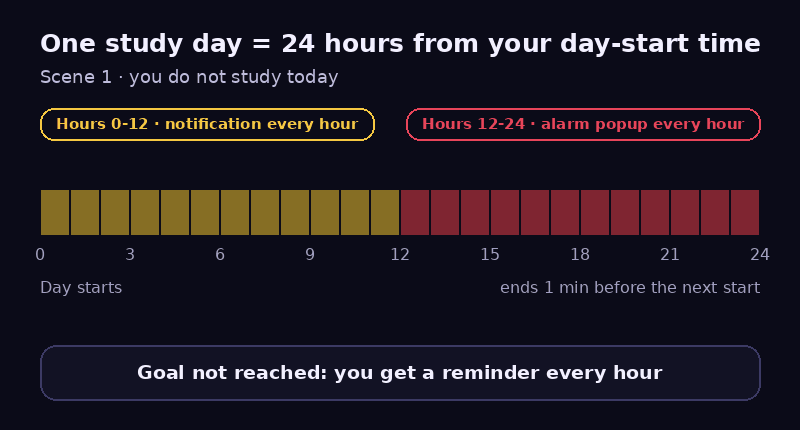
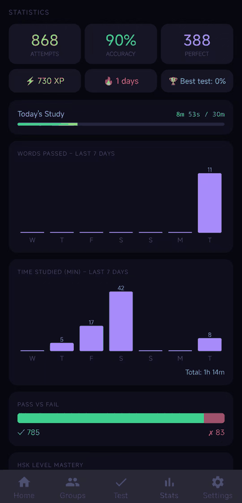
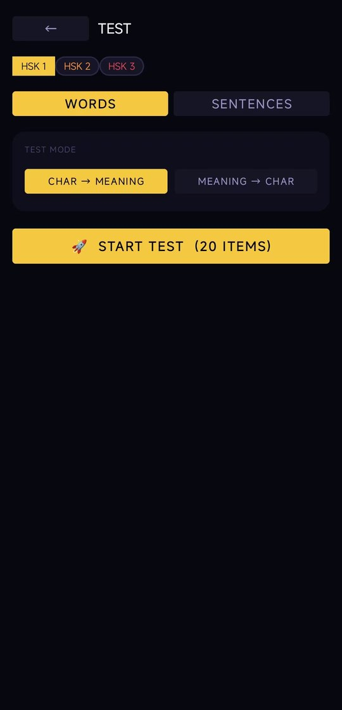
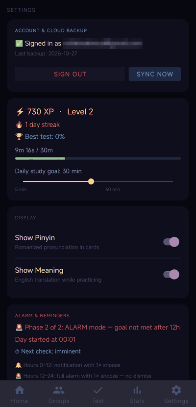

# Iqra Chinese 学

**Learn HSK 1–6 Mandarin vocabulary on Android: type the pinyin, type the meaning, hear every word, and let daily goals and reminders keep you studying.**


<p align="center">
  
  &nbsp;&nbsp;
  
</p>

## Contents

- [What you get](#what-you-get)
- [Home screen](#home-screen)
- [Practising](#practising)
- [Daily goal and your study day](#daily-goal-and-your-study-day)
- [Reminders and alarms](#reminders-and-alarms)
- [Stats](#stats)
- [Tests](#tests)
- [Settings](#settings)
- [Account and cloud backup](#account-and-cloud-backup)
- [Troubleshooting](#troubleshooting)
- [For developers](#for-developers)

> The animations in this guide are built from real screenshots of the app. They are illustrations, so timing differs slightly from the real thing.

---

## What you get

- **HSK 1–6 vocabulary.** The complete official lists for HSK 1, 2 and 3 (about 600 words) plus a starter set for HSK 4–6.
- **150+ example sentences** with a word-by-word breakdown.
- **Sound everywhere.** Most words and sentences ship with recorded audio, so they play even on phones whose text-to-speech is restricted (some Xiaomi/MIUI devices).
- **Active recall.** You type the pinyin *and* the meaning, instead of just flipping cards.
- **Daily goal, streak and 13 achievements.**
- **Hourly reminders** that turn into a full alarm if you still have not studied.
- **Stats** for accuracy, words passed and time studied.
- **Optional cloud backup** (Google or email) that restores everything on a new phone.
- **Works offline.** Only sign-in and backup need a connection.

---

## Home screen

<p align="center"></p>

1. **XP and day streak** at the top. XP grows with correct answers; the streak counts consecutive study days.
2. **Words mastered** across all levels (a word counts once you have answered it correctly).
3. **Today's study time** against your daily goal, with a progress bar.
4. **Level cards** show mastery per HSK level. **Tap a card to start word practice.**
5. **Sentences** opens sentence practice for that level.
6. **Locked levels.** The next level opens when you reach **80 %** mastery of the current one.
7. **Bottom bar:** Home, Groups (your own word lists), Test, Stats, Settings.

Scroll down on Home to see your achievements.

---

## Practising

### Word cards

Tap a level card on Home. Each card shows a Chinese word (pinyin and meaning appear as hints, unless you turn them off in [Settings](#settings)).

1. The **audio plays by itself and repeats every second** until you move on. Tap the speaker to replay, or the slow button to hear it slower.
2. **Type the pinyin** and press **Enter**. The cursor jumps to the next box.
3. **Type the English meaning**, then tap **Check**.
4. If **both** are right, you move to the next word.

Good to know:

- Word cards have **no Skip**. Get each word right once to move on.
- The meaning check is forgiving: any one of the listed meanings is accepted.
- **Hint** and **Add to group** buttons are on the card. Groups are your own lists of tricky words.
- Leave the app and come back later: **every level reopens at the card you stopped on.**
- Use the level pills at the top to switch level.

### Sentence cards

Tap **Sentences** on a level card. It works like word cards, with a few extras.

<p align="center"></p>

- A banner reminds you that **about 60 % of the key words** in your meaning must match.
- **Skip** goes to the next sentence.
- **Words in this sentence** (below the buttons) lists every word of the sentence with pinyin, meaning and its HSK level, taken from the same word list as the rest of the app.

### Typing the pinyin: what counts as correct

Capital letters, spaces, tone marks, tone numbers and punctuation are all ignored.

| You type | Accepted for *nǐ hǎo* |
|---|---|
| `nihao` | yes |
| `ni hao` | yes |
| `NI HAO` | yes |
| `nǐ hǎo` | yes |
| `ni3hao3` | yes |
| `nihau` | no |

Sentences ending in `.` or `?` work the same way: you may leave the punctuation out.

### The typing flow

<p align="center"></p>

Pinyin, **Enter**, meaning, **Check**. Pressing **Backspace in an empty meaning box** takes you back to the pinyin box.

### When something is missing or wrong

<p align="center"></p>

- **Left a box empty?** It gets a red border and a message under it. Nothing is counted against you.
- **Wrong answer?** Only the wrong box turns red and is cleared; the right one stays green so you do not retype it.
- **Both right?** Both boxes turn green and the next card appears.

---

## Daily goal and your study day

- Your **daily goal** is between **5 and 60 minutes** (30 by default). Set it with the slider in [Settings](#settings). The progress bars on Home, Stats and Settings, and the reminders, all follow it.
- Your **study day** does not have to start at midnight. In Settings you pick when your day starts (default 00:01). The day then runs **until one minute before the next start**: set it to 06:00 and your timer and streak reset at 06:00, not at 23:59.
- Saving a new day-start time **reschedules all alarms and notifications** straight away.

---

## Reminders and alarms

<p align="center"></p>

If you have not reached your goal yet:

| Part of your study day | What happens |
|---|---|
| **Hours 0–12** | A notification **every hour**, with one snooze |
| **Hours 12–24** | A **full alarm popup every hour**, with one snooze and no dismiss |

- **Reach your goal and everything for that day stops**, including an alarm that is already ringing.
- Reminders are **scheduled a week ahead**, so they keep working even if you do not open the app for days, and after a restart.
- A notification or alarm always shows the **Iqra Chinese** name and icon, so you know where the sound comes from.

To make sure alarms can show up:

- Allow **notifications** when asked.
- Grant **Display over other apps** (Settings has a button for it) so the alarm can pop up over whatever you are doing.
- On **Xiaomi/MIUI**, allow **Autostart** for the app (it asks you the first time).

---

## Stats

<p align="center"></p>

The two weekly charts are grouped by **study day** (see above), and the right-most bar is today. Scroll down for **mastery per HSK level**.

---

## Tests

<p align="center"></p>

1. Pick an **HSK level**.
2. Choose **Words** or **Sentences**.
3. For words, choose the direction: **Char → Meaning** or **Meaning → Char**.
4. Tap **Start test**. You get **20 random items** from that level.

Your **best score** is saved and shown on Stats and in Settings.

**Groups.** Add words you find hard to your own lists (from a word card) and practise just those from the **Groups** tab.

---

## Settings

<p align="center"></p>

**Top of the screen**

- **Account and cloud backup**: sign in or out, see the last backup date, **Sync now**.
- **Daily study goal** slider (5–60 min).
- **Show Pinyin** and **Show Meaning**: turn them off for a harder challenge. You still have to type both answers.
- **Alarm and reminders**: which phase you are in today and when the next check is.

**Further down**

- **Day starts at**: two wheels (hour and minute) and **Save**.
- **TTS status** with **Test TTS** and **Retry**.
- **Replay app tour** and the **overlay permission** button.
- **Danger zone**: *Reset progress* clears XP, streak and attempts on this device; *Reset everything* also removes groups and settings. A cloud backup is **not** deleted, so signing in again can bring your progress back.

---

## Account and cloud backup

You sign in once (email or Google). After that your progress is backed up automatically:

| What is saved | When |
|---|---|
| XP, streak, unlocked levels, achievements, best test | Whenever you leave the app, and about once a minute while you study |
| Every word and sentence you have practised, with its recent history | Same |
| **Minutes studied per day** (this is what feeds the time chart and today's timer) | Same |

- **New phone or reinstall?** Install the app and sign in with the same account. Your progress, today's study time and your Stats come back.
- **Sign out and sign in again** is safe. Nothing is lost or counted twice: for every number the larger value wins, and your history is merged.
- **Sync now** (Settings) and **Sign out** both push everything to the cloud first.

---

## Troubleshooting

**No sound.** Open Settings and look at the TTS line. Most words and sentences have built-in recorded audio, so they should still play. Use **Test TTS** and **Retry**, and on Xiaomi make sure the app is not restricted in battery or autostart settings.

**The alarm did not appear over my other app.** Check that *Display over other apps* shows as enabled in Settings, that notifications are allowed, and (on Xiaomi) that Autostart is on.

**My streak or timer reset at the wrong time.** Check **Day starts at** in Settings. The reset happens at that time, not at midnight.

**Progress is missing after a reinstall.** Sign in with the **same account** you used before. If you were not signed in, there is no backup to restore.

---

## For developers

**Stack:** Kotlin 1.9.22, XML + ViewBinding, single Activity with Navigation, MVVM (`MainViewModel` + `Repository`), Room, SharedPreferences, Firebase Auth and Realtime Database, Coil and Media3 (announcement banners). Android Gradle Plugin 8.3.1, Gradle 8.4, **JDK 17**, minSdk 26, compile/target SDK 34. Package `com.iqra.chinese`.

### Build

1. Install Android Studio with the Android 14 (API 34) SDK and JDK 17.
2. Create a Firebase project, add an Android app with package **`com.iqra.chinese`**, and add your debug **SHA-1**.
3. Download **`google-services.json`** into `app/`.
4. Enable the **Email/Password** and **Google** sign-in providers, and create a **Realtime Database**.
5. Put your Web client ID (the OAuth entry with `client_type: 3` in `google-services.json`) into `WEB_CLIENT_ID` in `ui/AuthFragment.kt`.
6. Set the database rules (below), then run `./gradlew assembleDebug`.

```json
{
  "rules": {
    "users": { "$uid": { ".read": "$uid === auth.uid", ".write": "$uid === auth.uid" } },
    "banners": {
      ".read": true,
      "active":   { ".write": false },
      "stats":    { ".write": true },
      "feedback": { ".write": true }
    }
  }
}
```

### Where things live

```
app/src/main/java/com/iqra/chinese/
├── MainActivity.kt          navigation, banners, lifecycle hooks (sync on leaving the app)
├── data/                    HskData (all words + sentences), Room, Prefs, Repository
├── ui/                      Home, Practice (word cards), Sentence, Stats, Settings, Test, Groups, Auth, AppTour
├── alarm/                   hourly scheduler, receiver, alarm service + overlay, alarm screen
├── tts/                     TtsManager and BundledTts (recorded audio lookup)
├── firebase/                FirebaseManager (sign-in + sync), BannerManager
└── util/PinyinMatch.kt      the pinyin comparison rules
app/src/main/res/raw/        recorded audio
```

### Adding vocabulary

- Words and sentences are Kotlin lists in `data/HskData.kt`.
  - Word id: `{level}_{characters}`, for example `2_帮助`. Tone is the first syllable's tone, `5` for neutral.
  - Sentence id: `s{level}_{number}`.
- Audio lives in `res/raw/` and is looked up **by the exact text**:
  - words: `w_<hex code points joined by _>.mp3` (for 帮助 that is `w_5e2e_52a9.mp3`)
  - sentences: `s_<sentence id>.mp3`
  - register each new file in `AUDIO_MAP` in `tts/BundledTts.kt`.
- Items without a bundled file fall back to the phone's text-to-speech.

### Cloud data layout

```
/users/{uid}/stats       xp, streak, bestTest, unlockedLevels, earnedAch, …
/users/{uid}/attempts    one entry per word/sentence: id, pass, fail, level, type, lastTs, history
/users/{uid}/time        { "yyyy-MM-dd": secondsStudied }  one value per study day
```

Nothing is pushed until the account's cloud data has been merged into the device, so a fresh install can never overwrite an existing backup.

### Announcement banners

Push a message to every user with one REST call (no app update needed):

```
PUT https://<your-db>.firebaseio.com/banners/active.json?auth=<DATABASE_SECRET>
{ "id": "2026-11-welcome", "title": "Hello!", "message": "New sentences added.",
  "imageUrl": "", "videoUrl": "", "actionLabel": "", "actionUrl": "",
  "feedback": false, "feedbackQuestion": "", "enabled": true }
```

A new `id` shows the banner again to everyone; `"enabled": false` hides it. Keep the database secret private.
