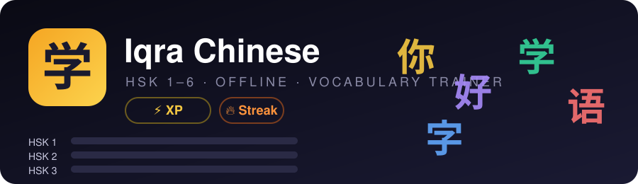
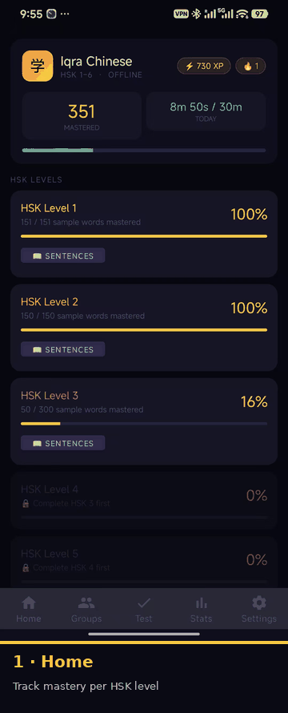
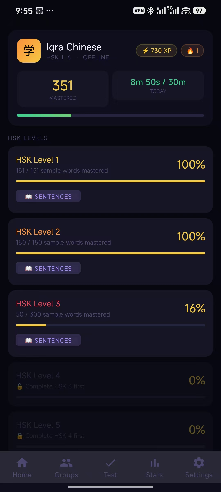
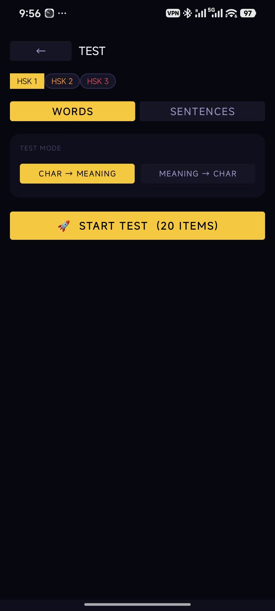
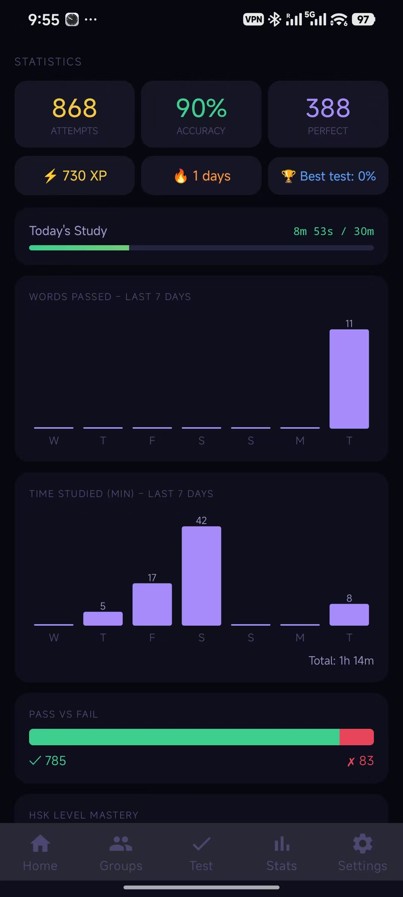
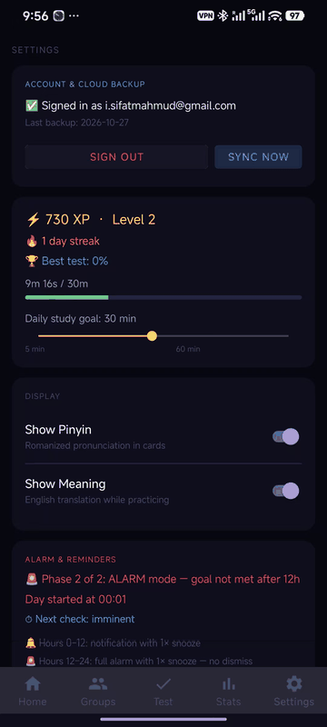
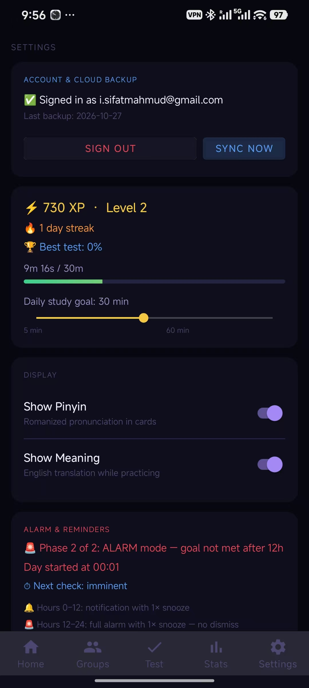
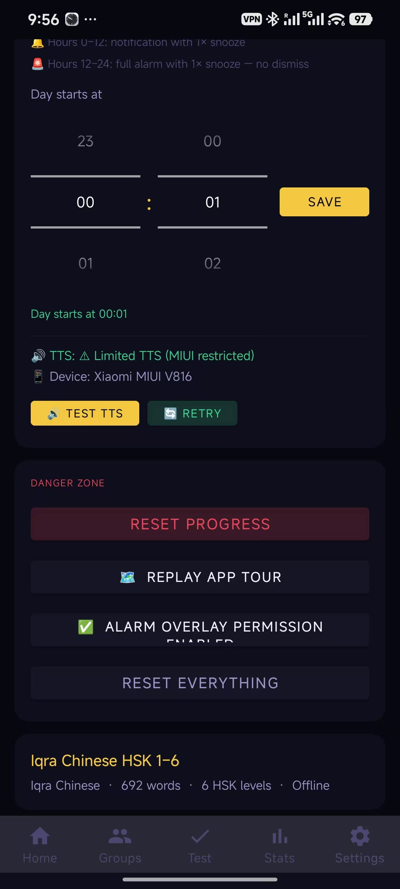
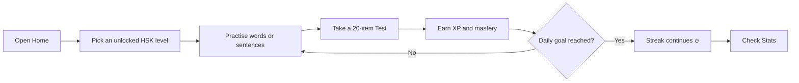

<p align="center">
  
</p>

<p align="center">
  <b>An offline HSK 1–6 vocabulary trainer for Android</b><br>
  Learn words and sentences, test yourself, keep a daily streak, and never miss a study session.
</p>

<p align="center">
  
  
  
  
</p>

---

## 📱 Quick tour

<p align="center">
  
</p>

The app has five tabs along the bottom: **Home · Groups · Test · Stats · Settings**.

---

## Table of contents

1. [Features at a glance](#features-at-a-glance)
2. [Home: your learning dashboard](#1-home--your-learning-dashboard)
3. [Test: quiz yourself](#2-test--quiz-yourself)
4. [Stats: see your progress](#3-stats--see-your-progress)
5. [Settings: tune the app](#4-settings--tune-the-app)
6. [Daily study loop](#daily-study-loop)
7. [Tips and troubleshooting](#tips-and-troubleshooting)

---

## Features at a glance

| Feature | What it does |
|---|---|
| **HSK 1–6 levels** | Words grouped by HSK level. Each level unlocks after you complete the previous one. |
| **Words and sentences** | Practise single words, or switch to example sentences for each level. |
| **Two test modes** | Character → Meaning and Meaning → Character, 20 questions per test. |
| **XP, levels and streaks** | Earn XP for correct answers and keep a daily streak going. |
| **Daily study goal** | Set a goal from 5 to 60 minutes and watch the timer fill. |
| **Statistics** | Accuracy, attempts, perfect answers, 7-day charts and pass/fail breakdown. |
| **Alarm and reminders** | Two-phase reminder that escalates if you haven't hit your goal. |
| **Cloud backup** | Sign in to back up and sync your progress. |
| **Offline first** | The full word list (692 words across 6 HSK levels) works without internet. |
| **Pinyin and meaning toggles** | Show or hide pronunciation and English translation while you practise. |

---

## 1. Home: your learning dashboard

<p align="center">
  
</p>

**Top card**

- **XP badge** (⚡) shows your total experience points.
- **Streak badge** (🔥) shows how many days in a row you've studied.
- **Mastered** is the total number of words you have mastered so far.
- **Today** is the time studied today against your daily goal, for example `8m 50s / 30m`. The green bar underneath fills as you study.

**HSK levels**

- Each level card shows how many words you have mastered (for example `50 / 300`) and a percentage.
- Tap a level to start practising its words.
- Tap **📖 SENTENCES** on a level to practise with sentences instead of single words.
- Levels that are not yet available are greyed out with a 🔒 and a hint such as *"Complete HSK 3 first"*. Reach 100% on the previous level to unlock the next.

---

## 2. Test: quiz yourself

<p align="center">
  
</p>

1. **Pick a level** with the HSK 1 / HSK 2 / HSK 3 tabs at the top (only unlocked levels appear).
2. **Choose the content**: `WORDS` or `SENTENCES`.
3. **Choose a test mode**:
   - `CHAR → MEANING`: you see the Chinese character and pick the meaning.
   - `MEANING → CHAR`: you see the meaning and pick the character.
4. Tap **🚀 START TEST (20 ITEMS)**.

Your best test score is stored and shown on the Stats and Settings screens.

---

## 3. Stats: see your progress

<p align="center">
  
</p>

| Section | Meaning |
|---|---|
| **Attempts** | Total number of answers you have given. |
| **Accuracy** | Percentage of correct answers. |
| **Perfect** | Number of answers you got right on the first try. |
| **XP / days / Best test** | Total XP, current streak, and your best test score. |
| **Today's Study** | Minutes studied today versus your goal. |
| **Words passed, last 7 days** | Bar chart of words you passed each day. |
| **Time studied (min), last 7 days** | Bar chart of study minutes per day, with a weekly total. |
| **Pass vs Fail** | Green and red bar showing correct (✓) and incorrect (✗) answers. |
| **HSK level mastery** | Mastery per level (scroll down). |

---

## 4. Settings: tune the app

<p align="center">
  
</p>

### Account and cloud backup

<p align="center">
  
</p>

- Shows the account you are signed in with and the date of the **last backup**.
- **SYNC NOW** uploads your progress immediately.
- **SIGN OUT** disconnects your account.

### XP, level and daily goal

- Your XP and current level (for example `730 XP · Level 2`), streak and best test.
- Drag the **Daily study goal** slider anywhere from **5 to 60 minutes**.

### Display

| Toggle | Effect |
|---|---|
| **Show Pinyin** | Shows romanized pronunciation on cards. |
| **Show Meaning** | Shows the English translation while practising. |

### Alarm and reminders

The app nags you in two phases if you haven't reached your daily goal:

| Phase | When | Behaviour |
|---|---|---|
| **Phase 1** | Hours 0–12 of your day | Notification with 1× snooze |
| **Phase 2** | Hours 12–24 | **Full alarm** with 1× snooze, no dismiss until you study |

The card tells you which phase is active and when the next check happens.

<p align="center">
  
</p>

- **Day starts at**: choose when your "day" resets (hour and minute pickers), then tap **SAVE**.
- **TTS (text-to-speech)**: tap **TEST TTS** to check pronunciation audio, or **RETRY** to re-initialise it. On some devices (for example Xiaomi MIUI) TTS may show as *Limited*.
- **Alarm overlay permission**: shows ✅ when enabled. The full alarm needs it to appear over other apps.

### ⚠️ Danger zone

| Button | What it does |
|---|---|
| **RESET PROGRESS** | Clears your learning progress. |
| **REPLAY APP TOUR** | Shows the first-run walkthrough again. |
| **RESET EVERYTHING** | Wipes all data and settings. Use with care. |

At the bottom you'll also see the app summary: **692 words · 6 HSK levels · Offline**.

---

## Daily study loop



A good routine:

1. Open **Home** and check the `Today` timer.
2. Practise your current level until the timer reaches your goal.
3. Run a **Test** in both modes (Char → Meaning, then Meaning → Char).
4. Check **Stats** to spot weak days and aim for an unbroken streak.
5. Tap **SYNC NOW** in Settings to back up your progress.

---

## Tips and troubleshooting

- **Can't open HSK 4 or higher?** Finish the previous level first. Locked levels show which level you must complete.
- **Alarm doesn't appear over other apps?** Make sure *Alarm overlay permission* shows ✅ in Settings.
- **No sound on cards?** Tap **TEST TTS**, then **RETRY**. Install or enable a text-to-speech engine in your phone's system settings if needed.
- **Want less distraction while testing yourself?** Turn off **Show Pinyin** and **Show Meaning** in Settings.
- **Changing devices?** Sign in and use **SYNC NOW** before you leave, then sign in on the new device.

---

## Project assets

```
.
├── README.md
├── make_animations.py        # regenerates the GIFs from the screenshots
├── animations/
│   ├── banner.svg            # animated header
│   ├── app-tour.gif          # cross-fade tour of all screens
│   └── settings-scroll.gif   # scrolling walkthrough of Settings
└── screenshots/
    ├── 01-home.jpg
    ├── 02-stats.jpg
    ├── 03-test.jpg
    ├── 04-settings-top.jpg
    └── 05-settings-bottom.jpg
```
